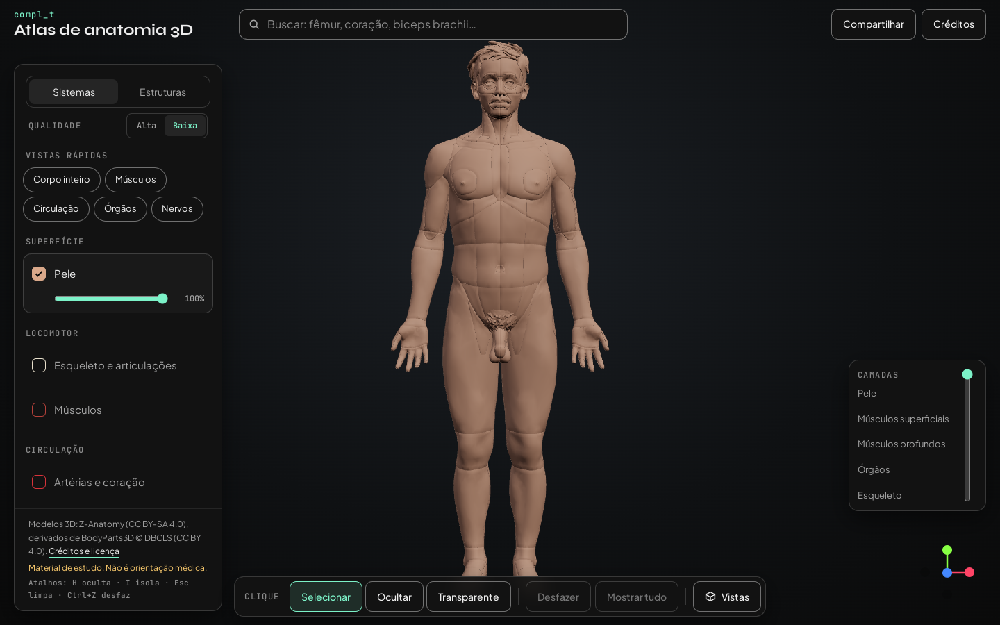
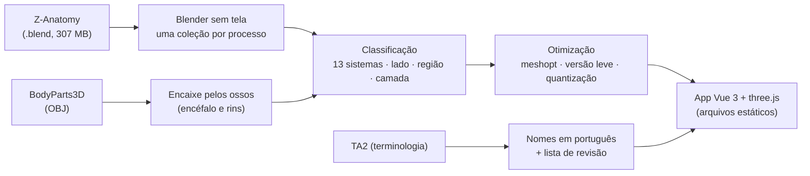
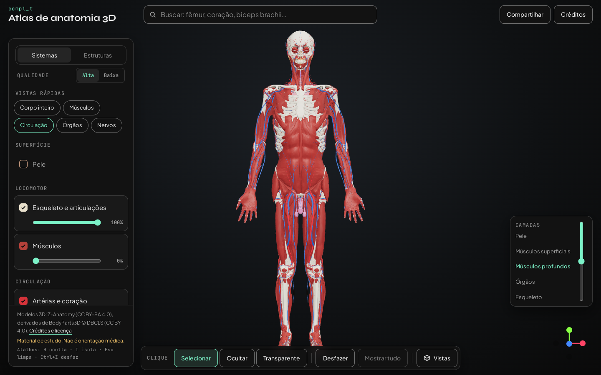
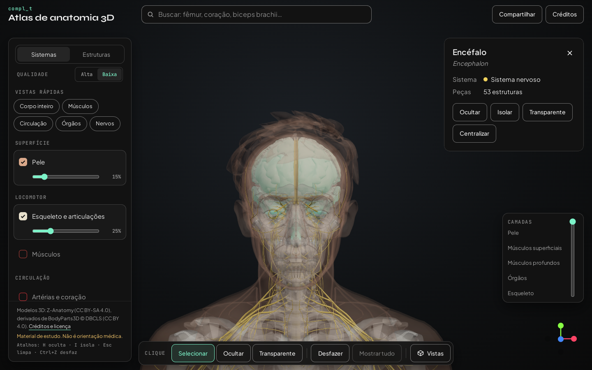
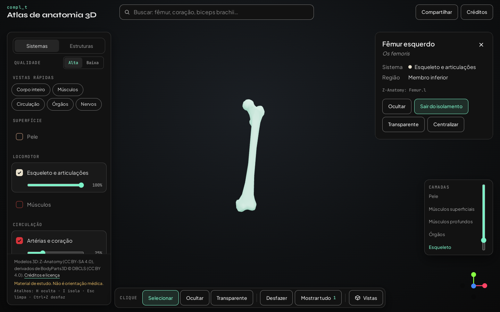
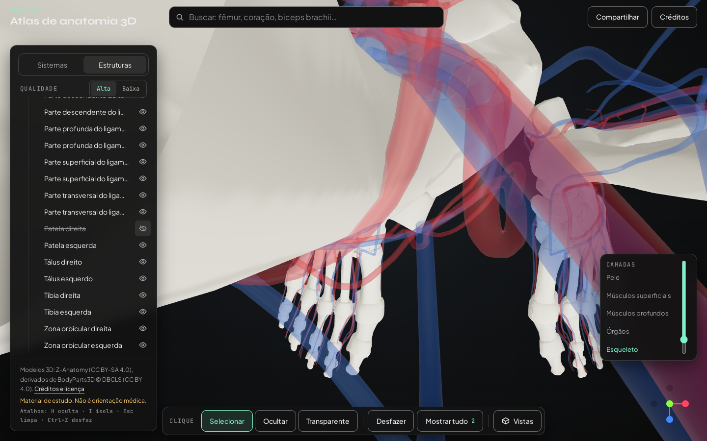
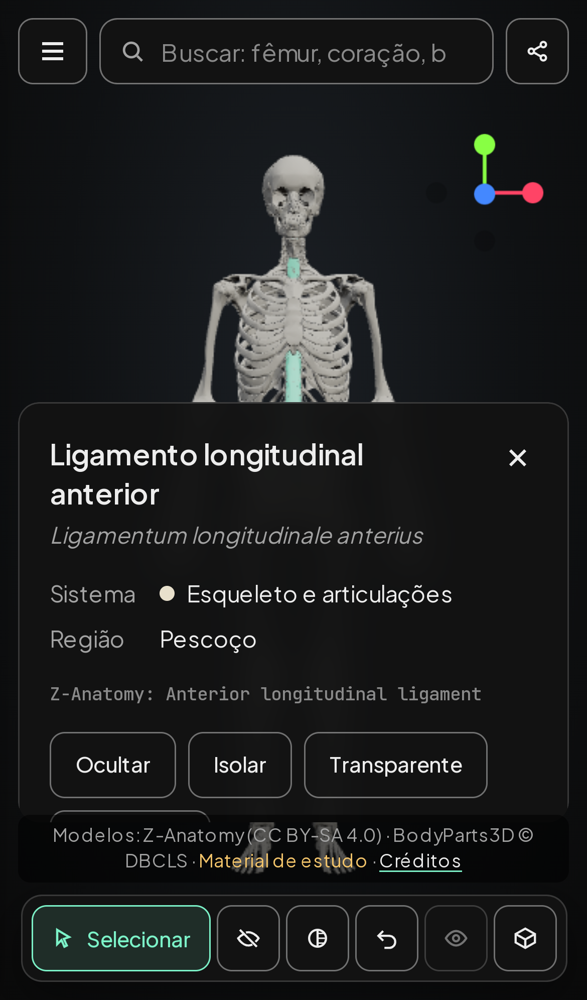

# Atlas de anatomia humana em 3D, no navegador

> Estudo de caso de engenharia de software, por **Filipe Lira**. O código é privado; aqui estão as decisões e os resultados.
> No ar: **https://complet.app.br/atlas/**. Material de estudo; não é orientação médica.

---

## Em uma frase

Quase 3 mil estruturas do corpo humano em 3D, com nome em português e em latim. A primeira tela abre em cerca de 2 segundos no celular, medido no site publicado, e cada vista tem um link para compartilhar.

## O problema

Atlas de anatomia bons costumam ser aplicativos pagos e pesados, ou estão em inglês. Os modelos abertos de qualidade existem: o **Z-Anatomy**, derivado do **BodyParts3D**. Mas eles vêm num arquivo do Blender de 307 MB, feito para o computador, e não para o navegador do celular.

## Meu papel

Tudo:
- o pipeline que transforma os modelos;
- o tratamento das licenças;
- os nomes em português;
- o visualizador 3D, a interface no computador e no celular;
- os testes no navegador;
- a publicação.

## Como funciona

| Número | Valor |
|---|---|
| Estruturas | 2.914, em 13 sistemas |
| Primeira tela (pele) | 0,57 MB transferidos. Medido no site publicado em 06/11/2026, num navegador sem placa de vídeo: 3,1 s no computador, 1,7 s no celular, 6,7 s no celular com 4G lenta |
| Todos os sistemas, versão leve | 4,2 MB (o original tinha mais de 300 MB) |
| Testes de navegador | 57 itens no computador e no celular, a cada entrega |

## Decisões de engenharia

| Decisão | Por quê |
|---|---|
| **Pipeline reproduzível, com fontes fixas** | Um comando baixa as fontes com versão e SHA-256 conferidos (Z-Anatomy, BodyParts3D, Blender 3.6 LTS) e gera tudo de novo, sempre igual. Os modelos não ficam no git: ficam no script. |
| **Uma coleção por processo, com teto de memória** | Abrir o arquivo inteiro derrubou a máquina de desenvolvimento (3,8 GB). Cada passo carrega só um sistema, num processo próprio. Pico de 0,5 a 1,6 GB. |
| **Licença tratada peça por peça** | O Z-Anatomy inclui modelos de terceiros com licença não comercial (rim, orelha interna) ou sem licença declarada (encéfalo). Essas peças saíram. O encéfalo e os rins voltaram do BodyParts3D original, encaixados pelos ossos do crânio e da coluna (erro de 2,4 mm no encéfalo). O que saiu, o que entrou e por quê está no arquivo de licença publicado junto dos modelos. |
| **Nenhuma peça pode sumir na otimização** | A simplificação automática apagava peças finas inteiras (126 das 256 regiões da pele, na primeira tentativa). Agora ela é feita peça por peça, e a peça que perde demais fica original. Uma conferência no fim para o processo se faltar alguma. |
| **Sem normais no arquivo** | Vasos e nervos são tubos; com as normais gravadas, a solda de vértices não juntava nada. Tirando as normais (o navegador recalcula), o sistema nervoso caiu de 12 MB para 2,1 MB. |
| **Versão leve primeiro, completa ao aproximar** | Os 5 sistemas grandes têm duas versões. A completa só é baixada quando a câmera chega perto. |
| **Endereço com o hash do arquivo** | Cada modelo é pedido com `?v=<hash>`. O servidor guarda em cache por um ano, e uma versão nova nunca fica presa. |
| **Nomes em português com revisão à vista** | A base é a terminologia anatômica do próprio Z-Anatomy (português de Portugal), adaptada ao Brasil por regras: acentos, grafia e concordância do lado ("fêmur direito", "artéria direita"). O que a regra não garante leva o selo "Tradução em revisão" e entra numa lista para conferir. |
| **Estado inteiro no link** | Sistemas, transparências, camadas, peças ocultas e isoladas, seleção e câmera vão para o endereço. Quem abre o link vê a mesma cena. Tudo o que vem do link é conferido antes de usar. |

## O que dá para fazer

- Ligar e desligar 13 sistemas, com a opacidade de cada um. Vistas rápidas: corpo inteiro, músculos, circulação, órgãos, nervos.
- Descer pelas **camadas**: pele, músculos superficiais, músculos profundos, órgãos, esqueleto.

- **Buscar** em português, latim ou inglês, sem acento e pelo teclado. Ao escolher, o atlas liga o sistema, deixa translúcido o que está por cima e leva a câmera até a estrutura.

- Clique para **selecionar, ocultar ou deixar transparente**; isolar; desfazer; mostrar tudo.
- Vistas de frente, costas, lados e cima, e eixos clicáveis.
- Atalhos: H oculta, I isola, Esc limpa, Ctrl+Z desfaz.

- **Árvore** sistema → região → estrutura, com o olho para ocultar cada peça.

- No **celular**: gaveta, ficha embaixo, toque para selecionar e barra que cabe na tela.

## Qualidade

- **Testes:**
  - Vitest para a busca, o estado e o link;
  - roteiro Playwright em navegador real, no computador e no iPhone simulado, que cobre cada recurso e mede o tempo de carga com rede e processador lentos.
- **Acessibilidade:** contraste conferido pelos tokens da marca, alvo de toque de 44 px, foco visível, rótulo em cada controle e respeito a "reduzir movimento".

## Créditos

Modelos 3D: Z-Anatomy (CC BY-SA 4.0), derivados de BodyParts3D © The Database Center for Life Science (CC BY 4.0). Os modelos e os nomes do atlas são obra derivada, sob CC BY-SA 4.0.

## Tecnologias

Vue 3 · TypeScript · Vite · Pinia · three.js · three-mesh-bvh · glTF / meshoptimizer · Blender (Python) · Playwright · Vitest · nginx
